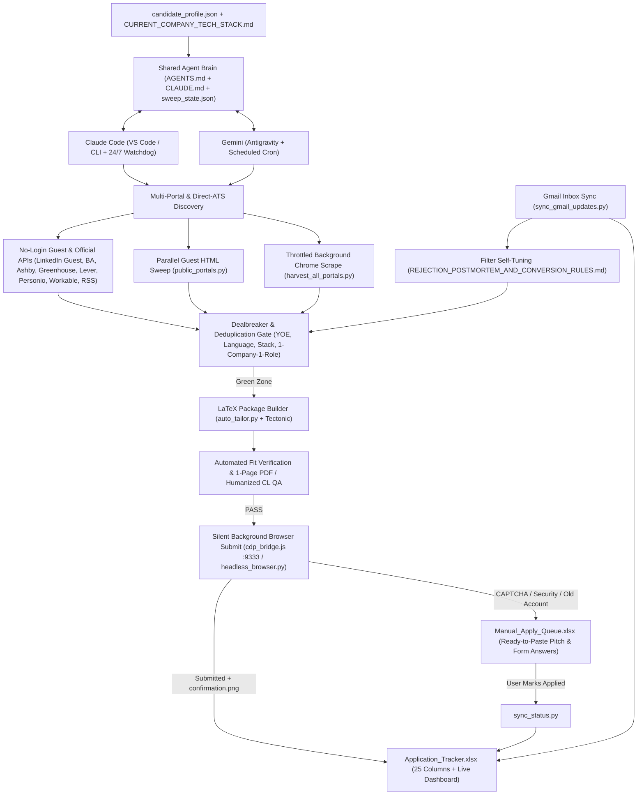

# JobPilot AI

**24/7 Dual-Agent Autonomous Job Discovery, Truthful LaTeX Resume & Humanized Cover Letter Tailoring, Silent Background Browser Application, Inbox Status Sync & Self-Tuning Engine — Synchronized Across Claude Code & Gemini (Antigravity).**

[](LICENSE)
[](requirements.txt)
[](package.json)
[](AGENTS.md)

---

## A Personal Note

I built this while going through the job search myself. Between rewriting resumes, filling out the same portal forms over and over, and dealing with rejections, it was a lot to go through. So I kept fine-tuning my own process day by day: keeping every resume 100% honest to my real work, writing natural cover letters, and tightening role filters whenever rejections came back.

Once everything was dialed in, within **6 days** and around **45 applications**, this setup honestly got me **1 interview and 3 screening rounds**. I'm sharing it publicly so anyone else going through a job search can set it up for themselves without burning out on the repetitive parts.

---

## Why JobPilot AI Exists

Manual job hunting forces a bad tradeoff: either send generic resumes at volume and get filtered out, or spend 45 minutes per application tailoring documents, re-typing identical form fields, and tracking statuses in spreadsheets. Meanwhile, running a single AI coding agent hits session or token quotas mid-sweep and loses context.

**JobPilot AI** turns **Claude Code** and **Gemini (Antigravity)** into a **synchronized, dual-agent autonomous pipeline** sharing one persistent on-disk brain:

- **Multi-Portal & Direct-ATS Discovery (Never Single-Portal):** Harvests fresh `< 24h` postings first, then sweeps `14-day` backlogs and runs perpetual `30-minute` incremental checks across **21+ job boards, public guest APIs, RSS/JSON feeds, and direct company ATS boards** (`Ashby`, `Greenhouse`, `Lever`, `Personio`, `Workable`, `Recruitee`, `SmartRecruiters`, `Teamtailor`, `JOIN`, `StepStone`, `Indeed`, `LinkedIn Guest API`, `XING`, `Arbeitsagentur`, `WeAreDevelopers`, `EnglishJobs`, `BerlinStartupJobs`, `GermanTechJobs`, `Wellfound`, and more).
- **Zero-Forgery, Per-Employer Truthful Tailoring:** Compiles a crisp, single-column **1-page LaTeX Resume** and a **100% humanized plain-paragraph Cover Letter** via [Tectonic](https://tectonic-typesetting.github.io/). Every bullet stays anchored to verified work per employer — zero fabricated skills, zero buzzword grafting, and zero cross-company stack contamination.
- **Automated Fit & Document QA Gates:** Every job package must pass automated fit verification (`gen_ats_analysis.py`, `ats_keyword_check.py`) and strict PDF + humanized-prose QA (`validate_resume_pdf.py` enforcing strictly 1 full A4 page, exact header links, zero duplicate skill rows, zero dashes/bullets/AI clichés in cover letters) before a browser tab is ever opened.
- **100% Silent Background Browser Submission:** Connects to Chrome over a persistent local CDP bridge (`http://127.0.0.1:9333`) that opens tabs strictly in the background with focus emulation (`background: true`), uploads PDFs first, waits for CV auto-parsers to settle, verifies live DOM field readbacks before clicking `Submit`, and saves `confirmation.png` proof — without stealing window focus while you work.
- **Ethical CAPTCHA & Account Guardrails:** Never solves or bypasses CAPTCHAs, Cloudflare Turnstile, hCaptcha, or anti-bot gates, and never resets passwords on pre-existing portal accounts. Blocked Green-Zone packages are automatically queued into `Manual_Apply_Queue.xlsx` with a ready-to-paste 3-sentence human pitch and exact screening answers so you can submit them manually in 20 seconds.
- **Dual Excel Trackers + Automated Gmail Inbox Sync:** Logs every submitted application across 25 structured columns + a live KPI `Dashboard` in `Application_Tracker.xlsx`, syncs manual submissions back automatically, and scans Gmail (`sync_gmail_updates.py`) for recruiter rejections, online assessments, and interview invitations.
- **Built for Software Engineering Out-of-the-Box — Configurable for Any Profession or Country:** Ships with a ready-to-run template profile (`Alex Morgan`, Software Engineering in Germany) and adapts cleanly to **Data Science, AI/ML, Product Management, Design, Finance, Operations, Mechanical/Electrical Engineering, or Consulting** in **any target country or language**.

---

## System Architecture



---

## Quick Start & Installation

### Prerequisites
- **Python 3.10+**
- **Node.js 18+** & `npm`
- **Google Chrome** (for the silent background CDP bridge and/or headless Playwright)
- **Claude Code** (VS Code extension or CLI) and/or **Gemini (Antigravity)**

### Install & Bootstrap Workspace

```bash
git clone https://github.com/Hithesh18/jobpilot-ai.git
cd jobpilot-ai

# 1. Install Python & Node dependencies
pip install -r requirements.txt
npm install

# 2. Initialize clean Excel trackers, sweep_state.json, gitignored logins file,
#    and auto-download the portable Tectonic LaTeX binary into _agent_handoff/bin/
python _agent_handoff/init_workspace.py

# 3. Verify synchronized status, Golden PDF QA gate, and language-filter regression tests
python _agent_handoff/sync_status.py
python _agent_handoff/validate_resume_pdf.py _agent_handoff/SAMPLE_GOLDEN_RESUME.pdf
python _agent_handoff/test_german_requirement.py
```

---

## Step-by-Step Configuration Guide

### Step 1: Add Your Personal Details & Verified Experience
1. **Edit [`candidate_profile.json`](candidate_profile.json):**
   Replace the placeholder `Alex Morgan` values with your real name, contact details, address, LinkedIn/GitHub/portfolio URLs, graduation or availability date, work-permit status, salary expectations, spoken language levels, target roles, target locations, and `permanent_do_not_apply` companies (current/past employers plus any company you never want contacted).
2. **Document Your Verified Stack Per Employer ([`_agent_handoff/CURRENT_COMPANY_TECH_STACK.md`](_agent_handoff/CURRENT_COMPANY_TECH_STACK.md)):**
   To prevent agents from guessing tools or mixing technologies across past jobs, open your own project or work repositories in read-only mode and run the prompt in [`_agent_handoff/EXTRACT_COMPANY_STACK_PROMPT.md`](_agent_handoff/EXTRACT_COMPANY_STACK_PROMPT.md). Paste the resulting factual stack boundaries into `_agent_handoff/CURRENT_COMPANY_TECH_STACK.md` and update `_agent_handoff/candidate_profile.md`.
3. **Configure Allowed vs. Excluded Skills ([`_agent_handoff/ats_keyword_check.py`](_agent_handoff/ats_keyword_check.py)):**
   Ensure `KNOWN` (or `custom_known_skills` in `candidate_profile.json`) lists only skills and concepts you genuinely know, and `NEVER` (`custom_never_skills` / `forbidden_resume_terms`) lists skills that must never be placed on your CV.

---

### Step 2: Customize Your Golden 1-Page LaTeX Resume & Humanized Cover Letter
1. **Master Resume ([`_agent_handoff/MASTER_RESUME_TEMPLATE.tex`](_agent_handoff/MASTER_RESUME_TEMPLATE.tex)):**
   - Replace the sample experience, education, thesis/research, projects, and certifications with your real history while preserving the clean single-column geometry and the 7 skill row labels (`Languages:`, `Web and Frameworks:`, `Data and Messaging:`, `Cloud and DevOps:`, `AI Engineering:`, `Testing and Tools:`, `Spoken:`).
   - Sync the key baseline bullet strings in `candidate_profile.json -> experience_anchors` so `auto_tailor.py` knows which baseline bullets it may re-frame per role archetype.
   - Check [`_agent_handoff/SAMPLE_GOLDEN_RESUME.pdf`](_agent_handoff/SAMPLE_GOLDEN_RESUME.pdf) for the target visual density: **strictly 1 full A4 page** (`>= 3,550` characters, `400–650` character Summary, zero awkward whitespace at the bottom).
2. **Master Cover Letter ([`_agent_handoff/MASTER_COVER_LETTER_TEMPLATE.tex`](_agent_handoff/MASTER_COVER_LETTER_TEMPLATE.tex)):**
   - Update the header contact block and signature name to match your profile, keeping the `__COMPANY_ESC__`, `__LOC_ESC__`, `__TITLE_ESC__`, `__CL_OPENING__`, `__CL_BULLET_1..3__`, and `__CL_CLOSING__` placeholders intact.
   - Both `auto_tailor.py` and `validate_resume_pdf.py` enforce **100% humanized plain-paragraph prose**: zero em/en-dashes (`—`, `–`, `--`, ` - `), zero bullet lists, zero bold inline subheadings, zero semicolons, and zero AI clichés (`"passionate"`, `"thrilled"`, `"leverage"`, `"synergy"`, `"seamlessly"`, `"tailored"`). See [`_agent_handoff/SAMPLE_GOLDEN_COVER_LETTER.pdf`](_agent_handoff/SAMPLE_GOLDEN_COVER_LETTER.pdf).

---

### Step 3: Workspace Layout & Dual Excel Trackers

```text
jobpilot-ai/
├── AGENTS.md                        # Shared single-brain protocol for Claude Code & Gemini
├── CLAUDE.md                        # Claude Code session instructions (@AGENTS.md)
├── AGENT_PLAYBOOK_MEMORY.md         # Persistent candidate & targeting rules summary
├── candidate_profile.json           # Centralized candidate config (single source of truth)
├── Application_Tracker.xlsx         # 25-column main tracker + live KPI Dashboard sheet
├── Manual_Apply_Queue.xlsx          # 18-column queue for CAPTCHA/manual portals + copy-paste answers
├── _private_account_logins.example.txt
├── _agent_handoff/
│   ├── init_workspace.py            # Generates clean Excel trackers, state & auto-downloads Tectonic
│   ├── profile_loader.py            # Dynamic profile & cross-platform binary resolver
│   ├── sync_status.py               # Cross-agent status check + Manual_Queue -> Tracker sync
│   ├── auto_tailor.py               # Per-job LaTeX Resume & Humanized Cover Letter builder
│   ├── gen_ats_analysis.py          # Automated fit verifier & per-job analysis generator
│   ├── ats_keyword_check.py         # Exact token & forbidden-skill verifier
│   ├── validate_resume_pdf.py       # Strict 1-page PDF & humanized cover-letter QA gate
│   ├── harvest_all_portals.py       # 21+ portal API/RSS + silent CDP harvester
│   ├── public_portals.py            # Parallel no-login guest portal sweeper
│   ├── ats_poll.py / ats_jd.py      # Direct Ashby/Greenhouse/Lever/Personio/Workable/Recruitee poller
│   ├── li_sweep.py / li_jd.py       # Throttled LinkedIn public guest API sweeper & reader
│   ├── ba_sweep.py / ba_api.py      # Official Arbeitsagentur REST API sweeper
│   ├── sync_gmail_updates.py        # Gmail inbox rejection / OA / interview status sync
│   ├── update_tracker_batch.py      # Styled 25-column upsert into Application_Tracker.xlsx
│   ├── update_manual_queue.py       # Styled 18-column upsert into Manual_Apply_Queue.xlsx
│   ├── claude_24x7_watchdog.ps1     # PowerShell 24/7 quota-recovery runner for Claude Code
│   ├── realtime_iter.sh             # Single 30-minute incremental sweep round
│   ├── cdp_bridge.js                # Persistent background-tab Chrome CDP bridge (127.0.0.1:9333)
│   └── cdp_scripts/                 # Reusable background DOM, ATS form, HRworks & Gmail helpers
└── <Company>_<Role>/                # Generated per-job packages (gitignored to keep repo clean)
    ├── Job_Description.txt
    ├── spec.json
    ├── ATS_Analysis.md
    ├── resume.tex & <Name>_Resume.pdf
    ├── cover_letter.tex & <Name>_Cover_Letter.pdf
    └── confirmation.png
```

- **`Application_Tracker.xlsx`:** Tracks every submitted role across 25 columns (`Application ID`, `Company Name`, `Job Title`, `Location`, `URLs`, `Application Date`, `Salary Range`, `Key Technologies`, `Fit Score`, `Resume/CL Paths`, `Application Status`, `Follow-up Date`, `Notes`) plus a live formula-driven **`Dashboard`** tab.
- **`Manual_Apply_Queue.xlsx`:** Whenever a portal presents a visual CAPTCHA, requires a passport/permit scan, or has an older pre-existing account, the agent writes the tailored PDFs + clickable URL + **`Copy_Paste_Pitch_Max_3_Sentences`** (Column Q) + **`Copy_Paste_All_Form_Answers`** (Column R). Once you submit manually and change `Manual_Status` to `Applied`, the next `python _agent_handoff/sync_status.py` run automatically updates `Application_Tracker.xlsx`!
- **`_private_account_logins.txt`:** Local-only (gitignored) log where the agent records newly created ATS portal credentials when "Sign in with Google" is unavailable.

---

### Step 4: Silent Background Chrome CDP Bridge & Account Safety

JobPilot AI supports two zero-popup browser modes:

#### Option A: Persistent Background Chrome CDP Bridge (Recommended)
1. Enable remote debugging in your Chrome browser:
   - Either launch Chrome with `--remote-debugging-port=9222`, **or** open `chrome://inspect/#remote-debugging` in Chrome 136+ and enable remote debugging.
2. Start the local background bridge in a terminal:
   ```bash
   npm run bridge
   # Listens on http://127.0.0.1:9333 -> BRIDGE_CONNECTED_OK!
   ```
3. Every helper in `_agent_handoff/cdp_scripts/` uses `Target.createTarget({ background: true })` + `Emulation.setFocusEmulationEnabled({ enabled: true })`, so tabs open silently in the background without ever popping up in front of your active window.

#### Option B: Isolated Headless Browser (`headless_browser.py`)
- Run completely detached from your main browser using an isolated persistent profile (`headless=True`):
  ```bash
  # Optional one-time interactive login if you want session cookies saved in headless_profile/:
  python _agent_handoff/headless_browser.py --login-once

  # Verify silent headless readiness:
  python _agent_handoff/headless_browser.py
  ```

#### Built-in Account-Safety & Ethical Rules
- **Guest APIs First:** LinkedIn searches and JD reads run strictly through unauthenticated public guest endpoints (`li_sweep.py`, `li_jd.py`) with polite random jitter (`3–7s`); `s_fetch_jd.js` refuses to open `linkedin.com` URLs inside logged-in Chrome.
- **Parallel Guest Sweeps:** `public_portals.py` sweeps public job boards without cookies, reserving logged-in Chrome sessions for submitting applications and throttled 30-minute checks on login-gated portals.
- **Zero CAPTCHA Bypass:** Agents never attempt to solve, click through, or bypass reCAPTCHA, hCaptcha, Cloudflare Turnstile, or anti-bot challenges.

---

### Step 5: Automated Email / Inbox Status Tracker

Keep `Application_Tracker.xlsx` automatically synchronized with recruiter replies in Gmail:

```bash
python _agent_handoff/sync_gmail_updates.py
```

- Opens Gmail silently in a background tab via `cdp_bridge.js` (`s_gmail_scan_updates.js`), ignoring job-alert newsletters and automated receipt confirmations.
- Matches real recruiter emails to tracked companies in `Application_Tracker.xlsx`:
  - **Rejections (`absage`, `unfortunately`, `not moving forward`, etc.):** Marks `Application Status` as `Rejected`, stamps the date and subject in `Additional Notes`, and generates a root-cause breakdown in `_agent_handoff/last_gmail_sync_report.json`.
  - **Positive Next Steps (`invite you`, `schedule a call`, `coding challenge`, `einladung`, etc.):** Advances `Application Status` to `HR Screening` so you see interview invites immediately on the `Dashboard` sheet.
- For email-only job ads (`jobs@...` / `karriere@...`), `_agent_handoff/cdp_scripts/gmail_helper.js` composes short (`<= 120` words), natural, human-written emails with your tailored Resume and Cover Letter PDFs attached and captures Sent-folder confirmation screenshots.

---

### Step 6: Fine-Tuning Filters After Rejections

Read [`_agent_handoff/REJECTION_POSTMORTEM_AND_CONVERSION_RULES.md`](_agent_handoff/REJECTION_POSTMORTEM_AND_CONVERSION_RULES.md) to see how JobPilot AI self-calibrates from real market outcomes:

1. Run `python _agent_handoff/sync_gmail_updates.py` after each wave of recruiter responses.
2. Inspect `newly_updated[*].reasons` and `fine_tune` recommendations in `_agent_handoff/last_gmail_sync_report.json`.
3. Update seniority gates (`RED_TITLE`, `HARD_YOE_KO`), spoken-language patterns (`GERMAN_KO` + regression cases in `test_german_requirement.py`), or role priorities in `candidate_profile.json` and `AGENTS.md`.
4. Because both Claude Code and Gemini read `AGENTS.md` and `REJECTION_POSTMORTEM_AND_CONVERSION_RULES.md` at startup, every filter improvement immediately applies to both agents.

---

### Step 7: Switching Seamlessly Between Claude Code & Gemini (Antigravity)

Both agents coordinate through `_agent_handoff/sweep_state.json`, `Application_Tracker.xlsx`, and `Manual_Apply_Queue.xlsx`:

- **Interactive Trigger (Either Agent):** Open this workspace in **Claude Code** or **Gemini (Antigravity)** and type:
  ```text
  run
  ```
  The active agent runs `sync_status.py`, drains any ready packages in `sweep_state.json`, sweeps `< 24h` postings first, advances unfinished `14-day` portal cursors (`state_upd.py --screened >= 15`), and transitions to `30-minute` real-time sweeps.
- **If One Agent Hits Token/Quota Limits:** Simply open the other agent (`Claude Code` <-> `Gemini Antigravity`) in the same folder and type `run` (or paste `_agent_handoff/CONTINUATION_PROMPT.md`). It picks up from the exact `APP-XXX` ID and portal page cursor saved in `sweep_state.json` with zero duplicate applications.
- **24/7 Unattended Watchdog (Windows PowerShell + Claude Code CLI):**
  ```powershell
  # Verify CLI + state in dry-run mode:
  powershell -ExecutionPolicy Bypass -File _agent_handoff\claude_24x7_watchdog.ps1 -DryRun

  # Start continuous 24/7 execution (auto-sleeps 15m on quota limits and resumes automatically):
  powershell -ExecutionPolicy Bypass -File _agent_handoff\claude_24x7_watchdog.ps1

  # Graceful stop at any time:
  New-Item -ItemType File -Path _agent_handoff\STOP_24X7 -Force
  ```
- **Single Incremental Real-Time Round (Bash / macOS / Linux / Git Bash):**
  ```bash
  bash _agent_handoff/realtime_iter.sh
  ```

---

## Copy-Paste First-Time Setup & Launch Prompt (Works for Any Role, Industry, or Country)

Right after cloning `jobpilot-ai`, copy the prompt below, paste it into **Claude Code** or **Gemini (Antigravity)** inside this repository, and attach or paste your current CV/resume:

```markdown
You are onboarding me into **JobPilot AI** (`AGENTS.md` + `CLAUDE.md`) in this repository so both Claude Code and Gemini (Antigravity) can discover, tailor, QA-verify, and submit job applications for me silently in the background.

Please guide me through first-time setup and verification step by step before starting applications:

### Phase 1 — Interactive Candidate & Target Market Onboarding
1. Read `README.md`, `AGENTS.md`, `candidate_profile.json`, `_agent_handoff/MASTER_RESUME_TEMPLATE.tex`, and `_agent_handoff/MASTER_COVER_LETTER_TEMPLATE.tex`.
2. Ask me (or extract from the CV/resume I share with you) for:
   - My full name, email, phone, full postal address, nationality, work-authorization / visa status, earliest start date / notice period, and salary expectations.
   - My official header links (LinkedIn, GitHub / portfolio / website).
   - My target profession & role titles (e.g., Software Engineer, Data/AI Engineer, Product Manager, UX Designer, Business Analyst, Mechanical Engineer, Financial Analyst, etc.), target seniority / YOE range, target country & cities (remote/hybrid/on-site), and spoken language proficiencies + language filter rules.
   - My verified skills/tools **strictly separated by each real employer, degree/thesis, and project** (plus any skills I do NOT have that must never appear on my CV), and any companies on my permanent Do-Not-Apply list.
   - If I have local project/work codebases on my machine that I want audited read-only, offer to run `_agent_handoff/EXTRACT_COMPANY_STACK_PROMPT.md` to build `_agent_handoff/CURRENT_COMPANY_TECH_STACK.md` with 100% factual accuracy.

### Phase 2 — Configure Profile, Portals, Skill Maps & Golden 1-Page Templates
1. Update `candidate_profile.json`, `_agent_handoff/candidate_profile.md`, and `_agent_handoff/CURRENT_COMPANY_TECH_STACK.md` with my verified details (removing all `Alex Morgan` placeholder data).
2. Adapt `_agent_handoff/MASTER_RESUME_TEMPLATE.tex`, `_agent_handoff/MASTER_COVER_LETTER_TEMPLATE.tex`, `_agent_handoff/ats_keyword_check.py`, `_agent_handoff/auto_tailor.py`, and the portal search URLs/queries in `_agent_handoff/harvest_all_portals.py`, `_agent_handoff/public_portals.py`, and `_agent_handoff/li_sweep.py` to match my profession, country, and job boards.
3. Run `python _agent_handoff/init_workspace.py --reset` so `Application_Tracker.xlsx`, `Manual_Apply_Queue.xlsx`, `_agent_handoff/sweep_state.json` (`APP-001`), `_private_account_logins.txt`, and the `tectonic` LaTeX compiler are cleanly initialized.
4. Compile my customized `MASTER_RESUME_TEMPLATE.tex` and a sample `MASTER_COVER_LETTER_TEMPLATE.tex` into `_agent_handoff/SAMPLE_GOLDEN_RESUME.pdf` and `_agent_handoff/SAMPLE_GOLDEN_COVER_LETTER.pdf`, then run `python _agent_handoff/validate_resume_pdf.py _agent_handoff/SAMPLE_GOLDEN_RESUME.pdf` until it passes strictly on **1 full A4 page** with zero errors and 100% humanized prose. Show me the compiled PDF paths so I can review and approve my Golden Resume & Cover Letter!

### Phase 3 — Verify Silent Browser Bridge & Launch
1. Check `python _agent_handoff/sync_status.py` and `python _agent_handoff/bridge_ensure.py` (helping me enable Chrome remote debugging on port `9222` or `chrome://inspect/#remote-debugging` if not yet connected).
2. Once I confirm my Golden Resume PDF looks great, start the synchronized `run` loop (`< 24h` fresh roles first -> `14-day` backlog -> `30-minute` real-time sweeps), logging all submitted applications to `Application_Tracker.xlsx` and routing any CAPTCHA/manual portals to `Manual_Apply_Queue.xlsx` with ready-to-paste human pitches and form answers!
```

---

## License

Released under the [MIT License](LICENSE).
